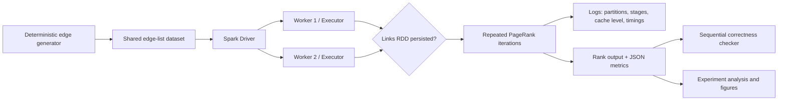

# Project 8: Spark Caching and Distributed Execution

This repository implements the CISC3010 Project 8 requirements with a small iterative PageRank workload. The same graph is executed with caching enabled and disabled on a documented local Spark cluster with two worker processes.

## Research question

When an iterative Spark application reuses the same input RDD, how much does caching change execution time, and when can cache materialization or memory pressure erase the benefit?

## Repository layout

```text
project8-spark/
  data/                 deterministic graph generator and sample inputs
  src/                  Spark application, experiment runner, verifier, analysis
  scripts/              Windows PowerShell entry points
  docs/                 architecture diagram and experiment notes
  report/               final report source and PDF renderer
  output/pdf/           final four-page report PDF
  presentation/         presentation deck and speaker notes
  results/              raw JSON/CSV results and figures
```

## Requirements

- Java 11 or later
- Python 3.10+
- PySpark 3.5.3
- A local machine with at least 4 GB RAM

Install Python packages with:

```powershell
python -m pip install -r requirements.txt
```

The code uses `local-cluster[2,1,1024]` by default. This starts one Spark driver and two local worker processes. All experiments use the same master, two workers, one core per worker, and the same partition count for cached and uncached runs.

## Quick demo

From the repository root:

```powershell
Set-ExecutionPolicy -Scope Process Bypass
.\scripts\run_demo.ps1
```

The demo creates a deterministic graph, runs PageRank with cache disabled and enabled, writes timing JSON, and runs a sequential correctness check. The Spark UI URL and cache storage level are printed in the log.

Manual equivalent:

```powershell
python data/generate_data.py --nodes 1000 --edges 5000 --out data/sample_edges.txt
spark-submit --master "local-cluster[2,1,1024]" src/run_pagerank.py `
  --input data/sample_edges.txt --iterations 6 --partitions 4 `
  --cache --output results/demo_cached.json --write-ranks
python src/verify_correctness.py `
  --input data/sample_edges.txt --spark-results results/demo_cached.json `
  --iterations 6
```

Repeat the run without `--cache` to create the comparison baseline.

## Required experiment

Run the complete experiment with:

```powershell
.\scripts\run_experiments.ps1
```

The runner compares cache disabled/enabled on three graph sizes and six iterations, with two repetitions per condition. It records initial materialization separately from later iterations. The analysis script writes:

- `results/raw_runs.csv`: every measured run;
- `results/summary.csv`: mean and standard deviation by condition;
- `results/cache_speedup.png`: mean subsequent-iteration speedup;
- `results/iteration_timing.png`: first materialization versus later iterations;
- `results/partition_observability.png`: partition and stage observations.

You can change the workload while keeping the comparison fair:

```powershell
python src/run_experiment.py --repeats 3 --iterations 9 --partitions 4
python src/analyze_results.py --results results/raw_runs.csv --out-dir results
```

## Correctness

The Spark implementation and the sequential reference use the same PageRank recurrence:

```text
rank_new(v) = 0.15 / N + 0.85 * sum(rank(u) / out_degree(u))
```

The verifier checks the final rank vector against the reference with a configurable tolerance, reports the maximum absolute error, checks that the cached and uncached outputs agree, and records the result checksum. Correctness is independent of whether the links RDD is cached.

## Architecture



## Connection to the reading

The project uses the RDD abstraction from Zaharia et al. (NSDI 2012). `links` is a reusable RDD; `persist(MEMORY_ONLY)` stores its computed partitions for later iterations. If an executor loses a cached partition, Spark can recompute that partition from the RDD lineage. The project simplifies the paper's cluster-scale fault model to two local worker processes and measures runtime rather than cluster-wide throughput.

## AI-use statement

AI coding assistance was used for project scaffolding, debugging suggestions, documentation wording, and test planning. The submitted code was checked by running the demo, inspecting Spark logs and outputs, comparing against the sequential reference, and reviewing the generated figures. The final interpretation reports measured results, including cases where caching provides little benefit because startup and materialization dominate.

## References

1. Matei Zaharia et al. “Resilient Distributed Datasets: A Fault-Tolerant Abstraction for In-Memory Cluster Computing.” NSDI, 2012.
2. Apache Spark. “RDD Programming Guide.” The project uses the current PySpark API for RDD persistence and local deployment.

## Prepared deliverables

- `output/pdf/project8_report.pdf`: four-page report with architecture, correctness evidence, experiments, interpretation, limitations, references and AI-use statement.
- `presentation/project8_spark_presentation.pptx`: eleven-slide presentation for the 20-minute slot.
- `presentation/speaker_notes.md`: demo sequence and likely questions.
