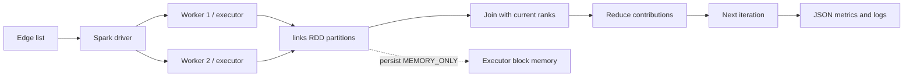

# Architecture and observability

The application contains one Spark driver and two local worker processes. The driver constructs a shared `links` RDD from a deterministic edge list. Each PageRank iteration joins that RDD with the current rank vector, emits contributions, reduces by destination node, and materializes the new rank vector with `count()`.

Observable evidence:

- `spark-submit` starts `local-cluster[2,1,1024]`.
- The application prints the Spark UI URL, default parallelism, partition count, storage level, and every iteration time.
- The Spark UI shows stages and storage blocks while the application is alive.
- The output JSON separates `materialization_s` from `iteration_s` and records the cache storage level.

The local cluster shares one physical laptop, so the experiment is a demonstration of distributed execution and RDD behavior, not a claim about cluster-scale performance.
